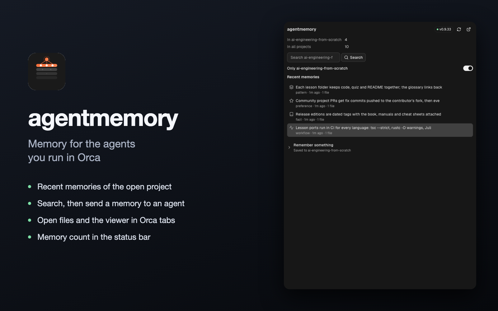

# agentmemory for Orca



A sidebar panel for [Orca](https://orca.dev) that shows the memories your coding agents keep in agentmemory. Tested with Orca 1.4.258.

The panel:

- shows whether the agentmemory server is running, its version, and how many memories the open project and all projects hold;
- lists the latest memories of the workspace you have open, or of all projects;
- searches memories and observations with agentmemory's smart search;
- opens a memory to read it, then opens the files it mentions in Orca's editor;
- sends a memory to an agent running in the workspace, typed into its prompt without pressing Enter;
- saves a memory you type to the workspace's project;
- opens the agentmemory viewer in an Orca browser tab.

The status bar shows the memory count of the open project. Click it to open the viewer. The command palette has `agentmemory: Open viewer` and `agentmemory: Refresh status`.

## Capture

Capture usually comes from each agent's own hooks and MCP server. Orca launches Claude Code, Codex and the other agents with their normal configuration, so connect each agent once:

```bash
agentmemory connect claude-code
agentmemory connect codex
```

For an agent that you cannot connect, turn on the **Capture agent tool calls** setting. The plugin then sends each tool call that an agent in Orca makes to agentmemory, with the tool output cut at 8,000 characters. Keep the setting off for connected agents, or each call is recorded twice.

## Install

Start agentmemory, then install the plugin in Orca from this folder of the repository:

```bash
npx @agentmemory/agentmemory
orca plugin install https://github.com/rohitg00/agentmemory/tree/main/integrations/orca
```

Orca shows what the plugin is allowed to do and asks you to approve it. Then the agentmemory panel shows in the right sidebar. To install from a checkout of this repository instead:

```bash
orca plugin dev load integrations/orca
```

## What the plugin can do

The plugin uses the `trusted-worker` execution profile. Its worker runs in Node.js with your user account's access, because the panel frame has no network access and the worker must call the agentmemory REST API. It asks for these capabilities:

- `settings:own`: read its own settings.
- `workspace:read`: read the focused workspace and the workspace list, to find the project name.
- `workspace:write`: open a memory's files in the editor and the viewer in a browser tab.
- `agent:read`: list the agents in the workspace, and refresh the panel when an agent finishes.
- `terminal:send`: type a memory into the prompt of the agent you pick. The plugin never presses Enter, and it types only when you press Send to agent.
- `notifications:show`: report errors of the palette commands.

The worker sends requests only to the Server URL. It reads the bearer secret from `AGENTMEMORY_SECRET`, then `~/.agentmemory/.env`, then `~/.agentmemory/secret`. It reads the local files only when the Server URL is a loopback address, and it refuses to send a secret over plain HTTP to a remote host. Set `AGENTMEMORY_CREDENTIAL_MODE=explicit` to turn off the local file lookup. The editor opens only paths inside the focused workspace.

## Project scope

agentmemory names a project after its Git repository, so all worktrees of a repository share one project. The worker finds the focused workspace's folder with `workspace.list` and resolves the name the same way the agentmemory hooks do. `AGENTMEMORY_PROJECT_NAME` overrides it. Remote (SSH) workspaces have no local folder, so the panel falls back to all projects for them and capture skips them.

## Settings

| Setting | Default | Purpose |
|---|---|---|
| Server URL | `http://localhost:3111` | The agentmemory REST server |
| Viewer URL | `http://localhost:3113` | Opened in an Orca browser tab |
| Capture agent tool calls | off | Send tool calls of agents in Orca to agentmemory |

## Develop

```bash
cd integrations/orca
orca plugin types .
orca plugin validate .
orca plugin test .
orca plugin check .
orca plugin dev watch .
```

`orca plugin test` runs the worker against a stand-in agentmemory server and the panel against a stand-in worker. `orca plugin check` renders the panel with the real worker.
